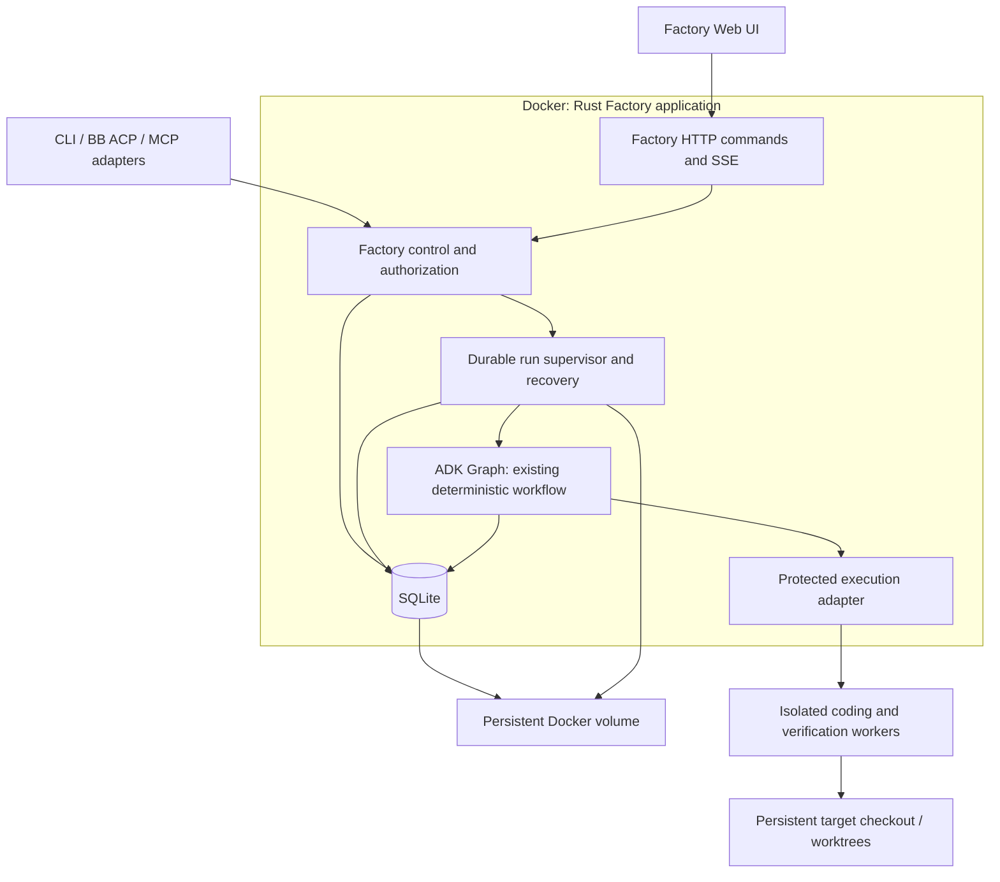

# ADK-Rust + SQLite migration assessment

Assessment date: 30 October 2026. Proposal for the initial deployment requested by
the user; application code has not been migrated. Initial inspection used the
prototype branch at `f433c6d6720e9823dad02f3feb2e140bf59c797f`; this assessment
was then reconciled with main at `6f2517c` and its shipped planning implementation
([PR #14](https://github.com/pessini/software-factory/pull/14)).
Upstream inspection: `zavora-ai/adk-rust` at
`911dc40f5c2125dd5a53c9f67cff3740df86619d`.

## Recommendation

The proposed single-host Docker deployment with SQLite is feasible. Treat the
change as a port of the Factory controller and its execution guarantees, with
ADK Graph replacing LangGraph. It is not a dependency substitution. Preserve the
deterministic graph and protected Codex worker behavior initially; changing the
agent execution model to direct ADK LLM agents would be a separate behavioral change.

Use an application-owned server entry point built around ADK components. Evaluate
ADK's durable background runs before writing a new scheduler. The launcher can
wire these services, but Factory commands, recovery policy, and SSE event replay
still belong to this application. Explicitly inject persistent services.

## What is actually present

| Area | Current implementation | Migration consequence |
| --- | --- | --- |
| Graphs | Implementation graph in [graph.py](../src/software_factory/graph.py) and a separate [planning graph](../src/software_factory/planning.py) | Port both graphs, including routes, state merge behavior, bounds, planning outcomes, and terminal outcomes |
| Persistence | [engine.py](../src/software_factory/engine.py) uses `AsyncSqliteSaver`; [persistence.py](../src/software_factory/persistence.py) stores runs, operations, events, sessions, interactions, and jobs in SQLite | There is no PostgreSQL removal to do in the current code |
| Control | [control.py](../src/software_factory/control.py) and [planning_control.py](../src/software_factory/planning_control.py) own implementation and planning operations | Port these shared boundaries and their persisted contracts |
| Interfaces | CLI, BB ACP, stdio MCP, and planning HTTP/UI share Factory control | Preserve these contracts or explicitly version/defer adapters |
| Browser | [web.py](../src/software_factory/web.py) serves the shipped planning UI and authenticated local HTTP API; see [planning documentation](planning.md) | Port the existing UI/API and add replayable SSE as needed; the earlier prototype is not the product baseline |
| Human input | Saved questions and answers, with replay validation and paused deadlines | Preserve this independently of framework interrupts |
| Plan approval | `PlanningControl.approve` validates the exact immutable plan hash and records one idempotent implementation handoff | Preserve the shipped revision-bound approval and handoff semantics |
| Worker protection | [worker_container.py](../src/software_factory/worker_container.py) invokes Apple Container and Codex App Server | Add a Linux/Docker execution backend; a controller Dockerfile alone is insufficient |
| Recovery | Durable dispatch intents, provider receipts, ownership locks, process identities, artifact integrity | Port and verify these guarantees; checkpoints alone do not replace them |

`review_approved` currently means an agent reviewer/judge approved the change.
It must remain distinct from a person's authorization to start implementation or
publish under a delivery policy. See [workflow_nodes.py](../src/software_factory/workflow_nodes.py)
and [delivery.py](../src/software_factory/delivery.py).

## Proposed initial architecture



The controller runs as one service instance on one host. It can manage multiple
workspaces with bounded concurrency, but only one writer per workspace. A
browser connection observes a saved run; disconnecting it must not cancel work.
Waiting for human approval persists state and releases execution resources.

Suggested storage layout, separate from writable target repositories:

```text
/var/lib/factory/             # named volume, private to controller UID
  factory.sqlite             # ADK graph/session tables + Factory domain tables
  artifacts/                 # manifests, plans, evidence, reports
  worker-records/             # operation receipts and continuation metadata
  ownership/                 # workspace claims and locks
/workspaces/                 # separate persistent checkout/worktree mounts
```

One database is possible because ADK exposes pool-based constructors. Sharing a
pool does not make framework checkpoint writes and domain-ledger writes one
transaction: retain explicit recovery for failures between them. Configure a
compatible SQLx SQLite pool, WAL, busy timeout, foreign keys, and an explicit
durability policy. Start with synchronous graph checkpoint durability. Keep
database transactions short and outside provider/network waits.

Persist the whole database directory, including WAL/SHM files. Use a local volume
and SQLite's backup API or a quiesced consistent snapshot; copying a live `.sqlite`
file alone is not a backup strategy. Include artifacts and receipts in recovery
backups and test restoration. Repositories and provider continuation state also
need persistence if an interrupted run must resume.

## Required implementation changes

1. **Create a Rust application boundary.** Add Cargo workspace/lockfile, pinned
   toolchain, Serde contracts, validated configuration, typed errors, and injectable
   execution/storage traits. Port `state.py`, contracts, settings, events, and
   control operations. Retain versioned JSON and event sequence semantics for clients.
2. **Port graph and workflow rules.** Translate topology from `graph.py`, node
   behavior from `workflow_nodes.py`, and checks/reconciliation from `runtime.py`
   and `engine.py`. ADK state channels must preserve scalar replacement semantics;
   repair counters must not double-increment on replay. Persist graph definition
   and domain-state versions so upgrades can reject incompatible resumptions.
3. **Wire all durable stores.** Enable `adk-graph/sqlite` and
   `adk-session/sqlite`, construct `SqliteCheckpointer` and
   `SqliteSessionService`, and retain Factory tables for operations, start request
   deduplication, jobs, ownership, events, interactions, and delivery authorization.
   Persist approval records too, whether using ADK's approval store or a domain store.
   If adopting ADK background runs, inject `SqliteRunStore`; its default run store
   is in memory, independently of session and graph persistence.
4. **Port approval as a domain command.** Preserve `PlanningControl.approve`,
   immutable planning revisions, plan hashes, and linked implementation runs.
   Carry forward the displayed plan revision,
   scope/document hashes, actor, decision, and time. Atomically bind approval and a
   stable start request to one run. Reject stale approval; repeated identical
   approval returns the same run. Later planning edits must not mutate its snapshot.
   Map ADK interrupt/resume to these records after proving restart behavior.
5. **Port protected execution.** Reimplement the `ExecutionManager` boundary and
   worker receipts around Codex App Server initially. Replace Apple Container
   create/start/inspect/stop with Docker equivalents and saved container IDs plus
   operation labels. Prove read-only specialists, writable Builder restrictions,
   Git protection, cancellation, timeouts, and uncertain-dispatch reconciliation.
   Preserve trusted argv-only quality commands and verification-only repeat rules.
6. **Port the HTTP service and UI, and add replayable SSE.** Inventory the shipped
   planning routes and preserve their contracts, authentication, and origin checks.
   The following implementation-run routes are proposals rather than descriptions
   of the existing planning API:
   `POST /runs`, `GET /runs/:id`, `POST /runs/:id/answers`,
   `POST /runs/:id/resume`, `POST /runs/:id/cancel`,
   `GET /runs/:id/events`, plus sessions/plans/approval/settings/artifacts.
   Validate stable idempotency keys and access to configured workspaces. Persist
   events before publishing; SSE IDs use saved sequence numbers, support replay
   after reconnect, and catch up before switching to live delivery. Bound slow
   subscriber buffers. Do not let clients choose arbitrary host paths.
7. **Replace detached Python jobs with service-owned execution.** Evaluate
   `BackgroundState` / `DurableWorker` with `SqliteRunStore` and Factory execution
   adapters first. ADK provides leases, idempotency/concurrency keys, parking, and
   wake endpoints; adapt their behavior to Factory rather than assuming parity.
   A custom `WorkflowExecutor` must override `execute_durable` (the default starts
   again from input), reuse its saved thread ID, observe cancellation, and report
   checkpoints. Graph interrupts need explicit waiting/wake integration; agent
   tool-approval parking does not establish this for custom graph workflows.
   In particular, lease-expiry retries must reconcile saved external operations
   before dispatch, cancellation must confirm worker exit, and finished-run
   retention must meet Factory history requirements (ADK defaults to 24 hours).
   Persist launch intent before scheduling. On startup, reconcile nonterminal runs and surviving
   workers before executing anything. Keep waiting approvals idle; uncertain
   operations stay `recovery_needed`. HTTP requests schedule work and return saved
   state. Shutdown saves stop/recovery state and accounts for owned workers.

   Ordinary ADK `/api/run_sse` directly streams a Runner invocation; use durable
   `/api/runs` for execution lifetime and a separate observation stream. Also guard
   Factory terminal states: `GraphAgent` can start a completed graph again on a
   later chat turn, which is unsuitable as an implicit Factory run command.
8. **Package and verify.** Add multi-stage Rust Dockerfile, Compose configuration,
   persistent mounts, health/readiness, graceful shutdown, and Rust CI. Serve the
   production UI from the same service if practical. Initially publish the port on
   host loopback; bind the process to `0.0.0.0` inside Docker so port mapping works.
   Add identity and authorization before any shared network exposure.

Worker isolation requires an explicit deployment choice: sibling Docker workers
through a controller-only daemon/broker, or a separately managed worker service.
If using the host Docker socket, the controller has host-level Docker authority;
workers must never receive the socket or controller storage. Sibling containers
must mount daemon-visible host paths or named volumes; a path inside the controller
container is not automatically a valid host bind source. Revalidate process
identity and cleanup across controller restarts/PID namespaces. Running all coding
tools in the controller container would require a different isolation design.

## Migration order and release gates

1. Build a small ADK + SQLite vertical slice with a fake execution adapter:
   start → save question/approval → terminate process → restart → resume → finish.
2. Port Factory stores, state transitions, and supervisor. Port routing and bounded
   workflow behavior using existing Python test cases as behavioral specifications.
3. Add the Docker worker backend and real Codex continuation, then verify isolation
   and crash recovery with the pinned provider.
4. Port existing HTTP/UI and durable planning/approval, add SSE observation, and
   retain or version CLI/ACP/MCP behavior.
5. Cut over only after parity checks. Drain existing Python runs or keep the old
   controller available for them; do not point ADK at LangGraph checkpoint tables.
   ADK and LangGraph checkpoint formats are different even though both use SQLite.

Required acceptance cases: duplicate starts and answers; conflicting answers;
stale plan approval; concurrent clients approving one revision; restart while
waiting; crash before/after dispatch and result persistence; same worker turn
reconciliation without duplicate request; retry/deadline persistence; cancellation
with live descendants; SSE replay without lost events; corrupted evidence;
backup restoration; and host/container restart with stable workspace identity.
Retain focused/risk reviews, evidence checks, settings, and authorized PR delivery
in parity scope unless deliberately deferred.

The implementation work and release gates are tracked in four issues:

| Order | Issue | Dependency |
| --- | --- | --- |
| 1 | [#16 — Rust/ADK runtime and durable SQLite execution](https://github.com/pessini/software-factory/issues/16) | Start here |
| 2 | [#17 — Workflow parity and protected Docker workers](https://github.com/pessini/software-factory/issues/17) | #16 |
| 3 | [#18 — Shared interfaces and approved-plan handoff](https://github.com/pessini/software-factory/issues/18) | #16; final integration with #17 |
| 4 | [#19 — Docker packaging and production cutover](https://github.com/pessini/software-factory/issues/19) | #16, #17, #18 |

Issues #9 and #10 are completed baseline work. Optional Router #13 and Wayfinder
#15 remain separate from this migration. Start implementation from current main
and reconcile any changes that land during migration before the final cutover.

## ADK evidence and limits

The inspected upstream workspace declares version `3.0.0`, Rust `1.95`, and
Apache-2.0 in [Cargo.toml](https://github.com/zavora-ai/adk-rust/blob/911dc40f5c2125dd5a53c9f67cff3740df86619d/Cargo.toml).
These are source-tree declarations, not verification that every crate at that
version is published or that this application compiles against it. Pin and test
a coherent revision/release before implementation.

Primary source confirms [SQLite graph checkpoints and pool injection](https://github.com/zavora-ai/adk-rust/blob/911dc40f5c2125dd5a53c9f67cff3740df86619d/adk-graph/src/checkpoint.rs),
[graph SQLite feature](https://github.com/zavora-ai/adk-rust/blob/911dc40f5c2125dd5a53c9f67cff3740df86619d/adk-graph/Cargo.toml),
[session SQLite feature](https://github.com/zavora-ai/adk-rust/blob/911dc40f5c2125dd5a53c9f67cff3740df86619d/adk-session/Cargo.toml),
and [launcher session-service injection with in-memory fallback](https://github.com/zavora-ai/adk-rust/blob/911dc40f5c2125dd5a53c9f67cff3740df86619d/adk-cli/src/launcher.rs).
The [graph execution configuration](https://github.com/zavora-ai/adk-rust/blob/911dc40f5c2125dd5a53c9f67cff3740df86619d/adk-graph/src/node.rs)
exposes checkpoint/resume and durability controls. Framework capability does not
establish Factory recovery parity. See the companion
[framework research](adk-rust-framework-research.md) for further source analysis.
ADK's [background-run server documentation](https://github.com/zavora-ai/adk-rust/blob/911dc40f5c2125dd5a53c9f67cff3740df86619d/adk-server/README.md)
documents durable stores, leases, cancellation, parked approvals, authentication,
and retention. Its claims still require verification against Factory's external
coding-worker crash cases.

This assessment used source inspection only. No Rust prototype, dependency build,
performance benchmark, or live Docker/provider acceptance was performed.
