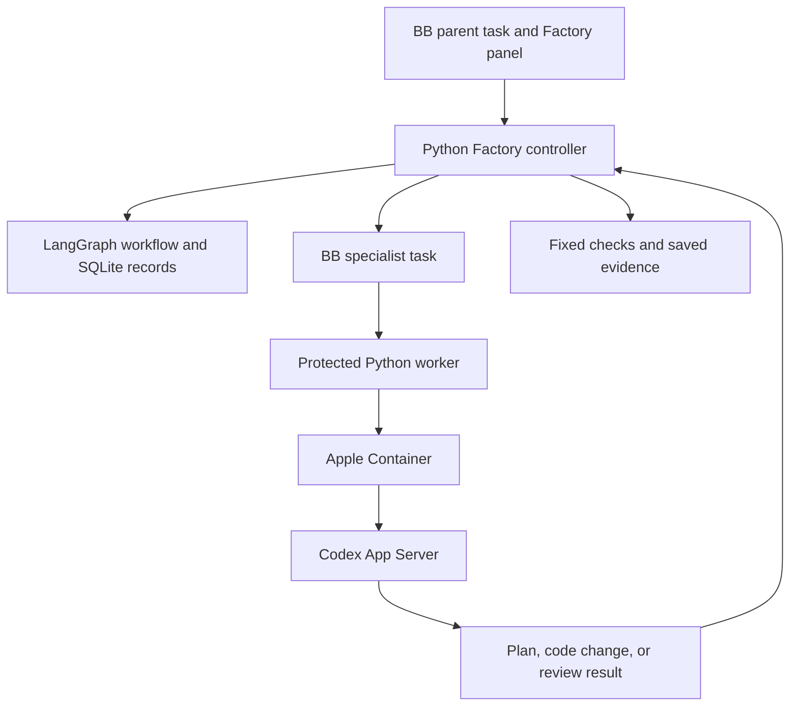
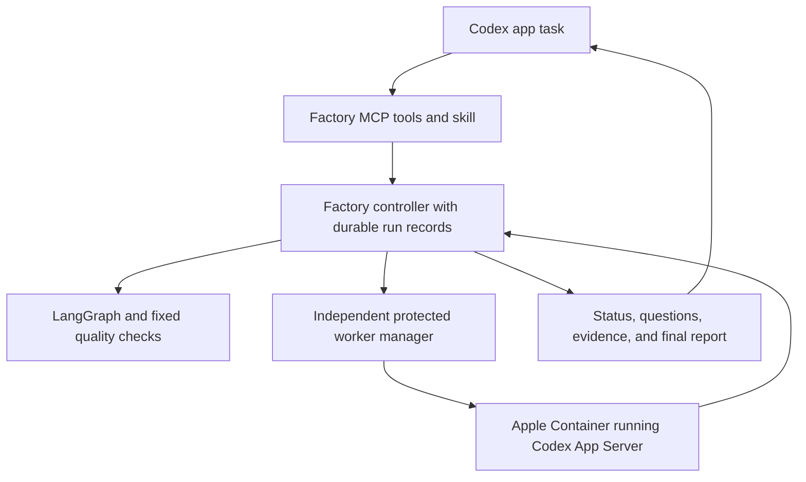

# Using Software Factory in the Codex app

Research date: 17 September 2026. Repository inspected: `3f683b9`.

**Decision: feasible, but full operation without BB needs code changes.** This repository can be opened, edited, and tested from the Codex app now. Its production workflow still requires BB to create specialist tasks, identify their owner, discover models, and locate saved records. The protected worker already runs Codex App Server. The main port is therefore task management and user controls, with careful preservation of recovery and file protection.

This is a feasibility study, not a completed integration. No provider run, plugin installation, account change, or production migration was performed. The companion [official capability research](codex-official-capabilities-research.md) gives further source detail. Some current official links redirect to ChatGPT Learn and describe Codex within the desktop app; this report retains the user's term “Codex app.”

**What “use in the app” can mean**

| Intended use | Assessment | What it requires |
| --- | --- | --- |
| Develop this repository in Codex | Available now | Python 3.14, `uv`, project commands, and permission for required process checks. |
| Start the existing BB workflow from Codex | Feasible with BB retained | A real BB parent task, matching project/environment IDs and storage, a running BB server, and the protected worker. A dedicated control tool would make this easier. |
| Run the complete Factory without BB | Feasible engineering work | Independent run context, direct worker management, model discovery, and controls exposed to the app. |
| Load the BB Factory panel directly as a Codex plugin | Not compatible as written | Replace the BB SDK calls and package format; implement new controls. |
| Display every specialist as a native Codex sidebar task | Not established | A separate compatibility test and a supported app integration contract. Do not promise this for container-created provider sessions. |
| Run this same setup as a cloud task | Not established | The present worker depends on local BB, Apple Container, and local storage. Local app compatibility does not establish cloud compatibility. |

The app supports local setup scripts, actions, and Git worktrees. These can prepare dependencies and run checks, but they do not supply BB's task context. [Official local environment documentation](https://learn.chatgpt.com/docs/environments/local-environment)

**What the code actually does**



This structure is established by [engine.py](../src/software_factory/engine.py), [protected.py](../src/software_factory/bb/protected.py), [worker.py](../src/software_factory/worker.py), and the [worker image](../containers/worker.Dockerfile). LangGraph selects the next step; it does not need BB to reason about the workflow. BB supplies the surrounding task system.

The image pins `@openai/codex@0.154.0` and starts `codex app-server`. The worker already sends `thread/start`, `thread/resume`, and `turn/start`. It saves provider thread and turn IDs, checks model choices, and accepts only output from the matching turn. This substantially reduces the model-execution work needed for a port. It does not remove the BB checks that precede dispatch.

**Concrete BB dependencies**

| Location | Current dependency | Port requirement |
| --- | --- | --- |
| [bb/context.py](../src/software_factory/bb/context.py) | Requires `BB_THREAD_ID`, `BB_PROJECT_ID`, `BB_ENVIRONMENT_ID`, `BB_THREAD_STORAGE` | Define a Factory-owned run identity and storage location. Keep BB context as one supported form. |
| [cli.py](../src/software_factory/cli.py) | Run and operational commands use the BB context | Add a supported way to select an independent Factory session. |
| [engine.py](../src/software_factory/engine.py) | Accepts `BBClientProtocol`, defaults to the BB implementation, saves BB identifiers | Add an execution implementation and versioned context data. Preserve old records. |
| [bb/client.py](../src/software_factory/bb/client.py) | BB commands for models, environments, creation, lookup, and continuation | Implement equivalent operations without BB. The existing protocol is a useful starting point. |
| [bb/protected.py](../src/software_factory/bb/protected.py) | Verifies the BB worker registration and child ownership | Replace those checks with Factory-owned worker authorization. |
| [bb/local_api.py](../src/software_factory/bb/local_api.py) | Local BB HTTP API and task storage lookup | Supply independent storage and worker records. |
| [worker.py](../src/software_factory/worker.py) | Validates parent, child, title, environment, and saved operation through BB | Separate this validation from provider execution; use durable Factory identities. |
| [session_settings.py](../src/software_factory/session_settings.py) | BB model source and ACP-specific configuration objects | Keep settings resolution; separate model discovery and presentation. |
| [acp_agent.py](../src/software_factory/acp_agent.py) | ACP entry point for BB | Retain for BB; add a distinct MCP control interface for Codex. |
| [Factory panel](../bb-plugin-factory-controls/server.ts) | BB settings, RPC, task/environment queries and server data paths | Rebuild the connection layer and package. Reuse form concepts where useful. |

Changing environment variable names is insufficient. The current implementation validates that the referenced BB environment points to the owned workspace and that the child belongs to the expected parent. Invented BB IDs fail these checks. Disabling `FACTORY_PROTECTED_WORKER` does not remove this problem: the old adapter intentionally rejects live execution because it cannot enforce the required file protection.

**The supported extension route**

Use Model Context Protocol (MCP), the tool interface that lets Codex call an external program. The app supports local command-based servers and Streamable HTTP servers. A Factory server would expose its existing operations as tools. This is a new interface to build; `software-factory acp` speaks a different protocol and cannot be used as an MCP command. [Official MCP documentation](https://learn.chatgpt.com/docs/extend/mcp)

A Codex plugin can package skills and an MCP server, with optional tool UI. Start with working tools and a small skill; package them once the behavior is tested. The BB panel's `@get-bb/plugin-sdk` and `bb.rpc` calls are not Codex extension points. Optional tool UI also does not establish access to the same permanent right-side tab that BB provides. [Official plugin documentation](https://learn.chatgpt.com/docs/build-plugins), [BB package](../bb-plugin-factory-controls/package.json)

No reviewed official source established that Codex can load this project's custom ACP agent as its selectable provider. Treat direct ACP installation as unproven. This is a limit of the verified evidence, not a claim that no private or future implementation can support it.

**Recommended design**



Keep Python responsible for workflow decisions, evidence, ownership, cancellation, and delivery. Codex supplies the conversational controls and specialist execution. This preserves what makes the project useful: a successful result must be supported by fixed checks and saved review evidence, rather than by a statement in a conversation.

Proposed tools, not existing commands:

| Tool | Intended result |
| --- | --- |
| `factory_start` | Validate the target and saved settings, start work, return a durable run ID. |
| `factory_status` | Return phase, latest event, outstanding question, and report location. |
| `factory_answer` | Save an answer against the exact interaction ID. |
| `factory_resume` | Reconcile the saved execution before continuing. |
| `factory_cancel` | Save a stop request and report whether cleanup is confirmed. |
| `factory_models` / `factory_settings` | List supported choices and validate per-step settings. |

Start and status must be separate operations. The documented default MCP tool timeout is 60 seconds; Factory operations can take much longer. A durable controller process should own the run independently of one tool call. Restarting the MCP connection must not duplicate the job. Cancelling an MCP request must not be treated as proof that workers stopped. [MCP configuration](https://learn.chatgpt.com/docs/extend/mcp), [existing recovery design](run-recovery.md)

The outer Codex task should not edit the same target while Factory owns it. Existing ownership locks coordinate Factory executors, not every unrelated program. Prefer a separate target worktree and make status tools resolve the actual worktree path. Keep all specialists for one run on that same target; creating an unrelated worktree for each role would break the shared evidence assumptions. [ownership.py](../src/software_factory/ownership.py), [official worktree documentation](https://learn.chatgpt.com/docs/environments/git-worktrees)

**Execution choices**

The lowest-change choice is to keep the existing protected App Server transport, remove its dependence on BB task storage, and add a Factory worker manager. App Server provides conversation and turn control, streamed events, approvals, and structured final output. Its existence does not mean a separately launched server controls the desktop app's sidebar. [Official App Server documentation](https://learn.chatgpt.com/docs/app-server)

The current official Python SDK is also relevant: `openai-codex` controls local App Server and includes a pinned CLI runtime. It could reduce custom protocol code. Evaluate it in a separate experiment before replacement: the current transport also manages container creation, protected mounts, exact version checks, operation receipts, and confirmed shutdown. An SDK does not automatically replace those responsibilities. If adopted, use `uv add openai-codex`; do not silently change the worker's pinned runtime. [Official SDK documentation](https://learn.chatgpt.com/docs/codex-sdk)

`codex exec --json` with an output schema is a simpler option for a small experiment. For this project, App Server is the better starting point because the worker already uses it and needs saved questions, exact turn tracking, and continuation. The choice is an engineering assessment, not an official requirement. [Official non-interactive documentation](https://learn.chatgpt.com/docs/non-interactive-mode)

Do not follow older advice to expose Codex itself through `codex mcp-server`: the current SDK documentation says that command was removed. The proposed Factory MCP server is a different component: it exposes Factory operations and calls App Server internally. [Official SDK documentation](https://learn.chatgpt.com/docs/codex-sdk)

**Safety and recovery that must survive the port**

The current worker gives planning and review roles read-only source access, limits Builder writes, protects Git metadata and controller evidence, and disables command network access. It isolates the provider login from agent commands. Preserve these rules and retest them with the new manager. Merely telling a specialist to read only does not reproduce the current controls. [worker_container.py](../src/software_factory/worker_container.py), [protected worker evidence](protected-worker.md)

Keep the saved operation record before dispatch, exact provider turn matching, and the rule against repeating uncertain requests. In the installed protocol schema, `clientUserMessageId` exists but has no declared exactly-once guarantee. Do not assume that using this field replaces recovery checks. Likewise, an app task marked complete is not evidence that a container and its processes have stopped. [worker.py](../src/software_factory/worker.py), [worker_records.py](../src/software_factory/worker_records.py), [runtime.py](../src/software_factory/runtime.py)

The new control tools need to validate workspace ownership and saved policy. Treat model-produced output as data. Keep delivery under the existing saved authorization; adding an MCP interface must not give a specialist unrestricted delivery or shell commands. Preserve the current `ready_for_review` evidence checks. [delivery.py](../src/software_factory/delivery.py), [runtime.py](../src/software_factory/runtime.py), [config.py](../src/software_factory/config.py)

Authentication is another compatibility check. This worker explicitly requires a local Codex `auth.json` file and mounts it read-only into the provider directory. Signing into the desktop app alone does not prove that this file is available in the required form. Check the supported login configuration without copying credentials into the repository. [worker_container.py](../src/software_factory/worker_container.py)

**Native task visibility and built-in agents**

This research task has app-provided task management tools. They establish that the assistant can manage app tasks in this session. They do not establish that an external Python controller or user plugin can invoke the same interface, or recover through it after a crash.

The installed 0.154.0 schema describes `threadSource` as an analytics classification and `sourceKinds` as a listing filter. Neither description guarantees sidebar registration. The current container also uses a separate `CODEX_HOME`, so shared desktop session visibility cannot be assumed. First deliver status, questions, and reports inside one app task. Treat individual native specialist tasks as a later, separately verified feature.

Built-in subagents and scheduled tasks can help operate a workflow, but replacing the controller with prompt instructions would require re-establishing its deterministic transitions, evidence, and recovery rules. Use a schedule as a trigger if needed; keep the saved run state in Factory. [Official scheduled task documentation](https://learn.chatgpt.com/docs/automations), [graph.py](../src/software_factory/graph.py), [persistence.py](../src/software_factory/persistence.py)

**Local checks performed**

- Python: 3.14.7. Installed Codex CLI: 0.154.0. `uv` and Apple `container` executables are present. Presence does not prove a running container service or a usable login.
- `uv run --frozen --no-sync software-factory graph --format mermaid` succeeded from this app task.
- Calling `BBContext.from_environment()` reported all four required BB variables missing. This directly confirms why the current full-run CLI is not ready to operate from an ordinary Codex task.
- `codex app-server generate-json-schema --experimental` succeeded into temporary storage. The installed schemas contain `thread/start`, turn settings, `clientUserMessageId`, `permissions`, `outputSchema`, and source classification fields. Schema presence is not a live provider test.
- A targeted 34-test set covers CLI behavior, worker validation, exact turn matching, and recovery. The initial restricted run returned 19 passes and 15 failures; saved reports for the failing recovery cases identify `Operation not permitted: 'ps'`. The same tests with process inspection permitted returned **34 passed in 54.34 seconds**, with 13 dependency deprecation warnings. No code change was needed. This checks the existing simulated workflow; it does not establish live Codex app integration.

Test command, with live provider and container tests disabled:

```bash
FACTORY_LIVE_CONTAINER=0 FACTORY_LIVE_PROVIDER=0 \
PYTEST_DISABLE_PLUGIN_AUTOLOAD=1 \
uv run --frozen --no-sync pytest -p pytest_asyncio.plugin \
  tests/unit/test_cli.py tests/unit/test_worker_container.py \
  tests/integration/test_worker.py tests/integration/test_operation_recovery.py
```

The controller uses `ps` to establish process identity and verify cleanup. A permission configuration that blocks process inspection cannot support its present execution design. Do not remove this check to make a test pass; place the controller in an execution context that supports its required operations, then verify the worker restrictions separately. An external MCP service has its own execution permissions; do not assume that the app's shell restrictions automatically protect that service or its workers. [processes.py](../src/software_factory/processes.py), [official sandbox documentation](https://learn.chatgpt.com/docs/sandboxing)

Historical acceptance in [acceptance-results.md](acceptance-results.md) applies to the recorded BB setup and commits, not to a future Codex app port. Also, [run-recovery.md](run-recovery.md) still contains old `accepted` state descriptions. Current CLI and runtime code use `ready_for_review`; use the code and current evidence rules for port acceptance.

**Suggested delivery sequence and proof required**

1. Add independent run context and worker storage. Retain BB as a supported path and preserve saved BB records. Test old-run inspection and clear separation of new records.
2. Extract worker execution from ACP and BB ownership lookup. Retain the container controls. Prove one complete simulated run, restart after dispatch, exact result matching, cancellation, and no duplicate dispatch.
3. Add MCP start/status/answer/resume/cancel controls. Prove that a tool timeout, app connection loss, or server restart leaves a recoverable run and does not create a second writer.
4. Add a small skill and model settings controls. Package a Codex plugin after tool behavior is stable. Prove that unsupported model choices fail before execution and settings cannot change an active run.
5. Run live acceptance on a disposable target: ordinary success, repair, review revision, saved question, controller crash, and cancellation. Repeat read-only and protected-file checks. Record actual model/effort, thread/turn IDs, content versions, and stopped containers.
6. Investigate native specialist task display and optional UI only if required. Do not make the first release depend on an undocumented app control interface.

The smallest useful milestone is one Codex task that starts Factory through tools, receives a run ID, shows progress and questions, and opens a verified report, with BB absent. The port is complete only after recovery and file protection pass under that arrangement. No reliable time estimate follows from documentation alone; the independent-worker experiment is the point at which implementation effort can be measured.
