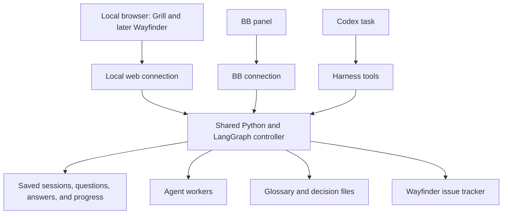

# Grill and Wayfinder interface options

Research date: 18 September 2026. This is a proposal for discussion, not an accepted architecture decision or an implemented feature.

Build one local web interface in this harness repository. Connect it to the independent Python/LangGraph controller proposed in [issue 9](https://github.com/pessini/software-factory/issues/9). Add BB controls and Codex tools as connections to that same service. Start with Grill; reserve Wayfinder for a later feature.

## What the existing material establishes

- [Issue 9](https://github.com/pessini/software-factory/issues/9) requires the controller to own saved runs, worker lifetime, questions, recovery, and settings independently of BB or Codex. It does not implement the new skill interfaces. The browser interface should be a follow-on, not an expansion that prevents the separation work from finishing.
- [The existing BB panel](../bb-plugin-factory-controls/app.tsx) proves that this project can supply a custom BB panel. Its [server code](../bb-plugin-factory-controls/server.ts) currently depends on BB task context and storage. Reuse its panel integration after separation; do not put new shared workflow rules there.
- [Saved interactions](../src/software_factory/interactions.py) and [persistence](../src/software_factory/persistence.py) already support questions, answer validation, and repeated-answer checks. These are useful foundations. They do not yet represent Grill rounds, decision dependencies, document changes, or Wayfinder maps.
- The installed [grill-with-docs skill](/Users/pessini/.agents/skills/grill-with-docs/SKILL.md) combines [grilling](/Users/pessini/.agents/skills/grilling/SKILL.md) with [domain modeling](/Users/pessini/.agents/skills/domain-modeling/SKILL.md). Grilling asks the questions whose prerequisites are settled, then recalculates the next round from the user's answers. Domain modeling maintains a glossary in `CONTEXT.md` and offers architecture decision records when a significant trade-off warrants one.
- The installed [Wayfinder skill](/Users/pessini/.agents/skills/wayfinder/SKILL.md) defines a planning map, decision tickets, dependencies, claims, and resolution comments. A map and its decisions live in the configured issue tracker, with local Markdown as the fallback. It normally resolves one decision ticket per session; research tickets are the exception.
- [grill-with-ui](https://github.com/jasonku09/grill-with-ui) demonstrates a small local browser interface connected to an agent through files and recorded events. See the [reference source review](grill-ui-reference-research.md) for its implementation and limits.

The installed skill files were inspected as requirements. No Grill or Wayfinder session was started.

## Options

| Option | Benefit | Cost or limit | Recommendation |
| --- | --- | --- | --- |
| Put the entire feature in a BB plugin | Fits BB's existing panel system | A second integration is needed for Codex; putting storage and rules here recreates the dependency issue 9 removes | Use BB as an optional view |
| Small local server controlled by an active skill session | Closest to the reference; small initial experiment | Saving a browser answer does not itself wake an idle desktop task; the active agent must read it | Good for a disposable interaction experiment |
| Shared web interface connected to the harness controller | Same questions and records from BB, Codex, or a browser; can resume after closing a client | Requires the independent controller and explicit Grill workflow | Recommended product direction |
| A new desktop application | Full control of window layout and application behavior | Adds packaging and maintenance before the interview behavior is proven | Defer |

An MCP Apps component is another possible presentation option. The [official UI guide](https://developers.openai.com/plugins/build/chatgpt-ui) documents components rendered inside ChatGPT and compatible hosts. It does not establish that this installed Codex version supports every such component. Test host support before depending on it; keep the browser version usable independently.

## Recommended ownership

The interface displays records and submits commands. The controller validates answers, saves progress, starts the next step, and manages workers. The skill describes how to interview and document decisions. A skill file alone does not supply the saved state or process that drives a browser application.

Keep the first version in this repository, for example with a `web/` directory for the interface and a Python web entry point alongside the controller. The paths are illustrative. Keep reusable screen code independent of BB imports. The BB plugin can initially open the local page; later it can render shared components through its own connection. Confirm BB embedding support before choosing an iframe.

Use the existing Python environment and SQLite storage foundation. Serve the built web interface and its data from one local service. React is a reasonable interface choice because the existing BB panel already uses it. There is no need to choose a new database, deploy a public server, or create a separate repository for the first version.

MCP means the tool connection through which Codex can start or inspect a session. Codex supports local command-based servers and HTTP servers. This differs from the HTTP connection used by the browser. They can be two entry points into the same controller. [Official MCP documentation](https://learn.chatgpt.com/docs/extend/mcp)

The existing protected worker already uses Codex App Server. Retain that worker connection initially. A new direct browser-to-App-Server client would add another place that manages conversation history, approvals, and execution. App Server is intended for custom Codex integrations, but it is not required merely to display the harness UI. [Official App Server documentation](https://learn.chatgpt.com/docs/app-server), [current worker](../src/software_factory/worker.py)

## Grill first

Suggested layout:

- Left: topic and decision tree, with answered, ready, and blocked questions.
- Center: the current round, recommendations, answer fields, and follow-up discussion.
- Right: glossary additions, proposed decision records, and links to supporting repository material.
- History: previous rounds and saved answers, with an explicit action to revisit a decision.

Keep the adaptive behavior: ask the currently independent questions together. Questions that depend on an unanswered question belong to a later round. A static form containing every possible question would change the skill's behavior.

Save each confirmed answer against its session, question, and revision. The model can suggest an answer; only the user's submission records the user's decision. Preview document changes and clearly separate proposed wording from saved decisions. When the user changes an earlier answer, identify later decisions that need review instead of silently retaining conflicting conclusions.

A useful first complete flow is:

1. Start a Grill session from Codex, BB, or the browser.
2. Display its current questions at a local address such as `http://127.0.0.1:<port>/sessions/<id>`.
3. Submit answers in the browser.
4. Save those answers before requesting the next agent step.
5. Generate the next round and update the document preview.
6. Close and reopen the page, then continue from the same saved session.
7. Confirm the final understanding and produce the agreed glossary and decision records.

Grill is a planning workflow. It should finish with its agreed records. Starting implementation should be a separate explicit action, not an automatic transition into the current Factory Builder step.

## The answer-to-agent connection

Two execution arrangements must be distinguished:

- **Active chat arrangement:** the desktop agent writes questions and waits for browser events. This is close to the reference and can validate the UI cheaply. Once the agent turn ends, the browser server alone does not guarantee that the desktop task will continue. Resume must be explicit or use a verified host integration.
- **Controller arrangement:** the controller saves the answer and schedules the next worker step. The outer Codex or BB conversation can close because it does not own that step. This matches issue 9 and is the recommended durable arrangement. The local service must still be running; saved state supports recovery after it restarts.

Do not keep one MCP request open for the whole interview. Start and status operations should return promptly, and the durable controller should own waiting and continuation. The [documented MCP tool timeout](https://learn.chatgpt.com/docs/extend/mcp) defaults to 60 seconds.

## Wayfinder later

Use the same application frame, saved-session controls, document panel, and Grill screen. Add a map view with decision cards and dependency lines, plus a simple list view. Show:

- destination and scope;
- decisions ready to work on, blocked decisions, and claimed decisions;
- areas not yet specific enough to become tickets;
- completed decisions, named links to their tickets, and supporting documents.

Opening a grilling ticket should open the same Grill screen with that ticket's context. Research and prototype tickets need their own actions. Preserve Wayfinder's planning purpose and live human participation where required.

The issue tracker remains authoritative for the map, ticket dependencies, claims, and resolution. The harness owns execution state and question sessions; a browser cache must not become a competing tracker. Keep tracker identity separate from the harness session identity. Concurrent claims and external ticket edits need checks when this feature is implemented.

Do not build Wayfinder's full dependency editor now. Give a Grill session an optional external decision reference so a future Wayfinder ticket can open it without changing the interview screen.

## Proposed delivery order

1. Complete the controller separation and shared question/answer operations from issue 9. UI experiments with example data can run independently of that work.
2. Add a follow-on Grill feature: one browser screen, saved rounds and answers, document previews, and restart recovery. Add only the workflow needed for Grill.
3. Connect Codex through shared tools and add a BB opener or panel over the same operations.
4. Test a session moving between views, browser refresh, controller restart, repeated submissions, stale answers, and accepted document updates. These are proposed checks, not completed tests.
5. Add Wayfinder only after Grill is useful in real work. Start with tracker-backed viewing and opening a decision, then add editing and research coordination as needed.

This investigation inspected source and documentation. It did not install the reference project, start model workers, publish issues, or verify a live browser integration.
