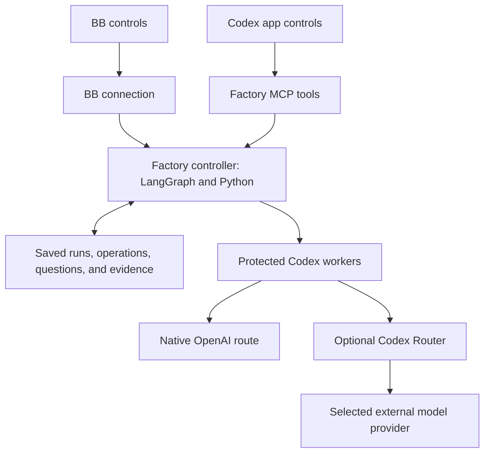

# LangGraph as the controller, with BB or Codex as the interface

Research date: 18 September 2026. Factory source: `3f683b9`. Codex Router source inspected at [`5e1b49e6e3fea1ada57f0e7fa6ca7612e9d17300`](https://github.com/duolahypercho/codex-router/tree/5e1b49e6e3fea1ada57f0e7fa6ca7612e9d17300).

**Yes: LangGraph can own the workflow while BB and Codex provide interchangeable controls. Codex Router can optionally connect Codex workers to other model providers. Installing the router alone does not make the interfaces interchangeable.**

This report extends [the Codex app feasibility study](codex-app-feasibility.md). The [router capability research](codex-router-capabilities-research.md) records further source findings. This was a documentation and source inspection; the router was not installed or executed, and no provider requests were made.

## Three distinct responsibilities

| Responsibility | Proposed owner |
| --- | --- |
| Accept a request; display progress, questions, and reports | BB or Codex interface |
| Choose workflow steps, models, reviews, retries, budgets, and completion; save state | Factory controller built with LangGraph and Python |
| Execute a bounded coding task and use permitted tools | Protected worker, currently Codex App Server |
| Translate a Codex model request for another provider | Optional Codex Router |

The current project already places workflow branching in [graph.py](../src/software_factory/graph.py) and durable operation records in [persistence.py](../src/software_factory/persistence.py). LangGraph supports saved checkpoints and pauses for external input. Switching interface should address the same Factory run and saved graph state. A BB conversation ID, a Codex conversation ID, and a LangGraph thread ID are different identities and must be mapped explicitly. [LangGraph persistence](https://docs.langchain.com/oss/python/langgraph/persistence), [interrupts](https://docs.langchain.com/oss/python/langgraph/interrupts)

Codex Router's architecture documentation states that command execution, permissions, MCP tools, skills, and task state stay in Codex. The router handles model inference and external-model history compaction. Thus it does not supply LangGraph execution, Factory recovery, or BB-to-Codex task transfer. [Router architecture](https://github.com/duolahypercho/codex-router/blob/5e1b49e6e3fea1ada57f0e7fa6ca7612e9d17300/docs/HOW-IT-WORKS.md)

## Recommended arrangement

MCP is the tool interface through which Codex can call Factory. Expose a small set of operations: start, inspect, answer, resume, cancel, and settings. Both interfaces should call the same implementation. The controller should run independently of either chat connection. Use a saved run ID, request IDs that prevent duplicate starts, and event positions so a reconnecting interface can request events it missed. [Official MCP documentation](https://learn.chatgpt.com/docs/extend/mcp)

For example: start a run in BB, close BB, open Codex, inspect the same run ID, and answer its saved question. The controller continues from its saved state. The Factory state and results move between views; the BB conversation itself does not automatically become a Codex conversation. Enforce one writer per workspace even when both interfaces are open.

With this arrangement, LangGraph owns all workflow policy. Codex still owns the internal tool loop of each Codex worker: for example, which file to read next during an assigned implementation step. If “all logic” includes every individual tool decision, that loop must also move into your own LangGraph agent implementation. Router installation does not replace it.

There is also an enforcement difference. A skill can instruct the outer Codex assistant to call Factory, but instructions alone do not prevent it from editing files through other tools. To make Codex strictly a control interface, restrict its direct write access to the target and give the protected Factory workers the required access. Keep run authorization in the controller.

## What changes in this repository

1. **Independent context and storage.** Replace mandatory BB context with Factory session/run ownership. Store checkpoints outside interface-owned task storage. Preserve existing BB records. Current [engine.py](../src/software_factory/engine.py) rejects an operation from a different parent task, so cross-interface resume needs deliberate authorization and migration rules.
2. **Independent worker management.** Separate worker creation, authorization, and cleanup from BB child tasks. Keep the exact operation and provider turn checks. [bb/protected.py](../src/software_factory/bb/protected.py), [worker.py](../src/software_factory/worker.py)
3. **Two interface connections.** Retain BB ACP presentation; add Codex MCP tools. Both use the same controller methods and saved settings. Start calls return a run ID quickly; disconnect is not cancellation.
4. **Separate runtime and model provider.** Today `provider: codex` describes the supported worker path. A routed worker can still run Codex while its model provider is DeepSeek or Anthropic. Store runtime, router route, actual upstream model, and actual effort separately. Do not replace `codex` with an external vendor name and expect the current worker to accept it.
5. **Versioned evidence.** Record the chosen interface separately from the worker and model. Changing interface should not change a run's model selection, deadlines, approvals, or evidence rules.

The existing [BBClientProtocol](../src/software_factory/bb/client.py) is a useful starting point for separating execution from presentation. It is not sufficient to rename it: worker authorization and storage still call BB directly.

## Router limits that affect this design

| Limit or behavior | Practical effect |
| --- | --- |
| It connects models; it does not execute your graph | LangGraph integration and interface switching still need implementation. |
| Fresh state enables automatic model failover | A quota failure can select another model. Disable it for fixed-model Factory runs, or make fallback a saved controller decision with evidence. Existing explicit settings are respected. |
| Some effort settings are translated or forced | The same “high” label need not mean the same upstream setting. Record the actual provider setting. |
| Tool compatibility varies by exact provider/model route | A model that answers text may reject forced tool calls or fail a later tool-result turn. Test the exact route. |
| Native subagent support is conditional | The encrypted-task relay requires ChatGPT sign-in. A model advertised as eligible is not sufficient proof that delegation and follow-up work. |
| External history compaction is lossy | Keep authoritative requirements and evidence in Factory storage, and supply them again for each step. Router conversation summaries must not become proof of success. |
| The image bridge may use another model | Fresh settings enable it. Image processing can send content to a second configured provider and consume extra quota. Select and record this deliberately. |
| The service binds to host loopback | The present isolated workers cannot use the host's `127.0.0.1` as though it were their own. A protected connection design is needed. |
| Voice and image generation are separate paths | Router support for an external text model does not replace the native realtime or image-generation services. |
| Local credential isolation is not offline inference | External model requests still go to the selected provider; provider quotas and access restrictions remain. |
| Integration depends on Codex behavior | Catalogs, transport, and model validation have version-specific handling. Pin and test Codex, Router, and its translation dependency together. |

Evidence for this table: [failover implementation](https://github.com/duolahypercho/codex-router/blob/5e1b49e6e3fea1ada57f0e7fa6ca7612e9d17300/src/model-failover.mjs), [vision defaults](https://github.com/duolahypercho/codex-router/blob/5e1b49e6e3fea1ada57f0e7fa6ca7612e9d17300/src/vision-bridge-state.mjs), [subagent verification](https://github.com/duolahypercho/codex-router/blob/5e1b49e6e3fea1ada57f0e7fa6ca7612e9d17300/docs/SUBAGENT-CERTIFICATION.md), [architecture and effort mapping](https://github.com/duolahypercho/codex-router/blob/5e1b49e6e3fea1ada57f0e7fa6ca7612e9d17300/docs/HOW-IT-WORKS.md), [security model](https://github.com/duolahypercho/codex-router/blob/5e1b49e6e3fea1ada57f0e7fa6ca7612e9d17300/SECURITY.md), [transport and voice troubleshooting](https://github.com/duolahypercho/codex-router/blob/5e1b49e6e3fea1ada57f0e7fa6ca7612e9d17300/docs/TROUBLESHOOTING.md).

Two details need particular care:

- The architecture guide says local settings cannot promote an unverified subagent model. The more specific certification guide and [implementation](https://github.com/duolahypercho/codex-router/blob/5e1b49e6e3fea1ada57f0e7fa6ca7612e9d17300/src/multi-agent-state.mjs) allow promotion by operator selection. Treat a catalog capability flag as a setting, not independent test evidence. Factory can avoid relying on native subagents by continuing to start and manage its own specialist workers.
- Disabling quota failover does not disable the router's separate native-model redirect setting. Check both. An App Server response naming the requested logical model is not, by itself, proof of the eventual upstream execution when a proxy can change the route. The port needs actual routing evidence or a configuration that rejects such substitutions.

## Why desktop installation does not configure these workers

[worker_container.py](../src/software_factory/worker_container.py) creates a separate `CODEX_HOME=/factory/provider` and mounts the Codex login file. It does not automatically mount the desktop router configuration or catalog. It also disables worker subagents, apps, and web search. Desktop availability of those features does not enable them in Factory.

The router's documented security model explicitly warns against exposing its ports on a shared network. Do not solve container connectivity by simply changing the listener to `0.0.0.0`. Design a private, authenticated transport or co-located provider arrangement, keep provider secrets inaccessible to agent commands, and repeat the file and command protection tests. This is engineering work, not a current supported setup demonstrated by this research.

## Could LangGraph appear as a selectable Codex model?

In principle, a custom server could accept Codex-compatible Responses requests and run a LangGraph workflow behind them. That requires implementing request and stream formats, conversation mapping, cancellation, tool results, errors, and any used compaction behavior. It is a custom integration project; Codex Router does not convert a Python graph into that server.

It also leaves an ownership question: does the graph execute tools, or return tool requests for Codex to execute? If both do so independently, the graph and Codex can disagree about state and completion. For this Factory, a direct control interface is easier to verify than presenting a long-running workflow as a model response. The router is optional when the only goal is switching BB and Codex interfaces. [Official App Server documentation](https://learn.chatgpt.com/docs/app-server)

## Recommended order

First make Factory independent of BB and prove that one saved run can be inspected and resumed from either interface. Then add one routed external model to a protected worker. Keep router failover and optional image processing off for that first trial, retain existing Factory validation, and test tool calls, structured results, repair, cancellation, and restart. Pin the tested versions and record the true upstream route.

This separates two independently useful outcomes: interchangeable interfaces and additional model choices. A failure in one does not require replacing the other.
