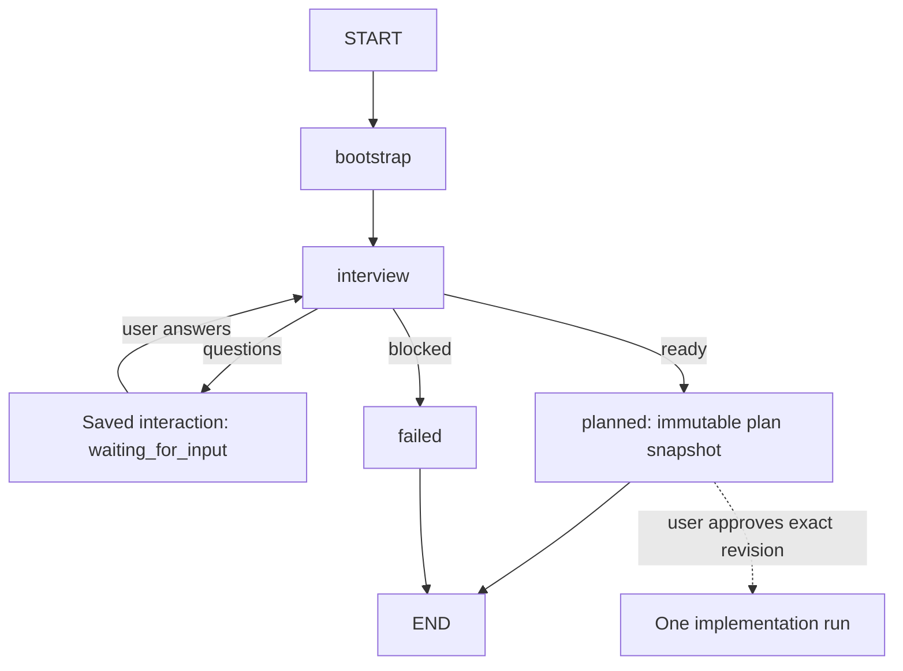

# Planning with Grill and the approved-plan handoff

Factory can plan a feature with an adaptive **Grill with Docs** interview before it
implements anything. You answer questions in a browser, BB, Codex, or the CLI. When
the plan is ready, you approve its exact revision, and Factory starts one ordinary
implementation run with that plan as settled input.

## Start the planning UI

```sh
software-factory web --workspace /path/to/target          # prints a local link with a token
software-factory plan "Add slugify for product URLs" -w /path/to/target
```

Open the printed `http://127.0.0.1:4317/?token=...` link. The token is exchanged
for a strict same-site cookie. The service binds only to `127.0.0.1`. It rejects
other `Host` headers, cross-origin writes, and non-JSON posts. It serves one user
and one workspace. Stop it with `Ctrl+C`. Saved sessions do not depend on it.

## How it works

Planning is a second LangGraph workflow (`src/software_factory/planning.py`). It
runs on the same run records, saved interactions, durable worker operations,
detached jobs, and cancellation as the implementation graph.



- **Read-only interviewer:** the Grill worker uses the protected, read-only Planner
  role and the Planner model setting. It reads the repository before it asks. Each
  round asks only questions whose prerequisites are settled, with a recommendation
  and the reason in context. Later rounds are recalculated from your actual answers.
- **Decisions belong to you:** only a submitted round records decisions. Unsent
  answers stay in the browser as visible drafts. Start an answer with `[discuss]` to
  ask about a question; the interviewer explains and asks the decision again.
- **Durable progress:** each round is saved before the next worker step. Closing
  the page, a BB or Codex conversation, or the web service does not cancel the
  session. A restart reconciles uncertain worker operations as usual.
- **Revisions are immutable:** a finished revision is a run with status `planned`.
  Its `plan-snapshot.json` is integrity-checked, and its sha256 is the plan hash.
  Revising starts a new run (revision N+1) from the earlier decisions and your
  feedback, and marks affected decisions for review. Earlier snapshots never change.
- **Workspace:** planning never writes the target. A planning run holds only its
  own run lock, so an approved plan can start implementation in the same workspace
  while other planning sessions continue.

## Approval and handoff

Approval names the exact plan hash. `approve` refuses any other hash. It calls the
shared start operation with the request ID `handoff:<planning run>:<hash prefix>`.
It records the implementation run against that revision. A repeated or lost-response
approval returns the same run.

The implementation request contains:

- the goal, scope, requirements, decisions with rationale, assumptions, exclusions,
  and deferred work;
- the planning session, revision, plan hash, and the document versions read;
- the completion checks, passed as required criteria;
- `planning-glossary` when glossary terms were agreed: the Builder writes them to
  `CONTEXT.md` with the approved wording;
- `planning-adr-<id>` for each decision marked as an architecture decision record
  under `docs/adr/`.

The implementation run keeps every existing rule: baseline, Planner validation,
Builder, checks, repair, review, and delivery policy. Approval grants no commit,
push, merge, or deployment permission. The implementation Planner may still ask
about new blockers, without restarting discovery.

## Interfaces

| Action | Browser | BB task | Codex MCP | CLI |
| --- | --- | --- | --- | --- |
| Start | New planning session | `/plan REQUEST` | `factory_plan_start` | `plan` |
| List / read | Session list and page | `/plans`, `/plan-status ID` | `factory_plan_list`, `factory_plan_status` | `plan-status [ID]` |
| Answer a round | Submit answers | `/plan-answer ID {"q":"a"}` | `factory_plan_answer` | `plan-answer` |
| Revise | Create new revision | `/plan-revise ID FEEDBACK` | `factory_plan_revise` | `plan-revise` |
| Approve | Checkbox + Start implementation | `/plan-approve ID HASH` | `factory_plan_approve` | `plan-approve` |
| Stop | Stop | — | `factory_plan_cancel` | — |

BB and MCP replies include the browser link when `software-factory web` is running
for the same storage. The implementation run is a normal run: use `/attach RUN_ID`,
`factory_status`, or `inspect` for its controls.

## Limits

- Wayfinder maps, tracker tickets, and claims are a later milestone; they are not
  implemented.
- A host-side read-only check runs around every interviewer turn. If an
  implementation run edits the same workspace during that turn, the planning
  revision stops as blocked; revise it after the implementation finishes.
- Approving a new revision while the previous implementation run is still active
  fails until that run finishes or is cancelled.
